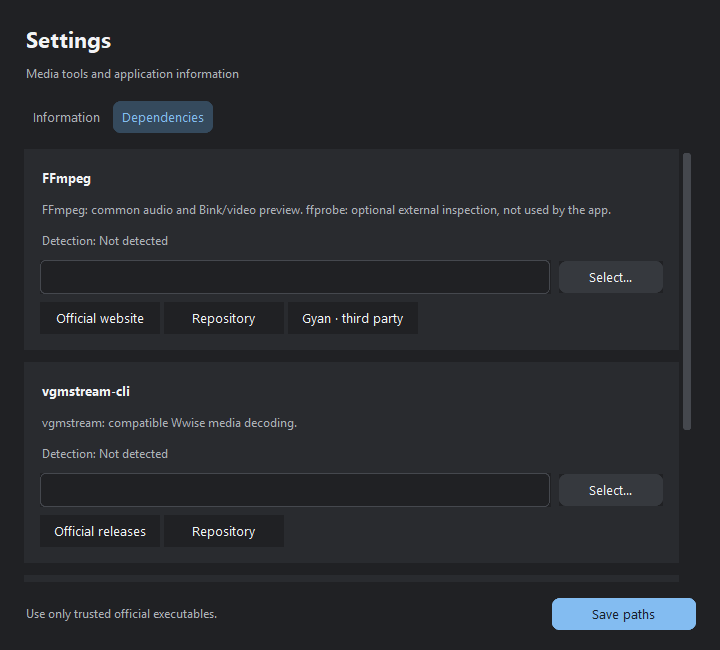

# ORC Asset Explorer

Desktop program for browsing and extracting **Resident Evil: Operation Raccoon City** files, with model, texture, audio and video previews.

[Português (Brasil)](README.pt-BR.md) · [Download program](https://github.com/TheNordicBlizzard/orc-toolkit/releases/tag/v1.1.0-rc.1) · [Changelog](CHANGELOG.md)

> **v1.1.0-rc.1 — prerelease.** Downloads contain only the Windows program with documentation/licenses. Blender addons and experimental tools remain in development in the repository and are not required to use Explorer.

## Everything the program can do

| Area | Available functions |
|---|---|
| Open and organize | SSG/backups, BNK/PCK banks, extracted folders and compatible loose media; search, category/extension filters and multiple selection. |
| Models | Supported FM6S 17/18, solid/textured/wireframe, resolved diffuse/UV, orbit/pan/zoom/reset, shadow helpers and manual skeleton overlay. |
| Textures | Complete DDS, PNG/JPEG/BMP/TGA; pan/zoom/fit/1:1 and PNG export. Stored image for manual model override. |
| Audio | Wwise BNK/PCK indexes, WEM inspection, decode/play/stop and WAV export with an external decoder. |
| Video | Up to 10 seconds through FFmpeg, configurable start, play/pause and PNG frame export. No synchronized audio. |
| Extraction | Selected/all source and installation batch, preserved paths, loose-file/bank options, inventory, progress and reports. |
| 3D export | FBX, `.blend` and GLB through external Blender; diffuse/PNG and verification of reopened outputs. Resolved skeletons, when available, have no validated deforming binding. |
| Inspection | Properties, material references, initial text/hex, source details, actual GPU, messages and logs. |
| Settings | Persistent Portuguese/English, dependency paths, file-existence detection and official links. |
| Safety | Read-only sources, destination protection, no overwrite/unsafe paths and cancellation preserving completed outputs. |

## Install and start

1. Download **`ORC-Asset-Explorer-Windows-x64-v1.1.0-rc.1.zip`** from the release.
2. Extract the entire ZIP to a writable folder outside the game. Do not run inside the ZIP.
3. If needed, install the [official Microsoft Visual C++ v14 x64 prerequisite](https://aka.ms/vc14/vc_redist.x64.exe).
4. Open **`ORC_Asset_Explorer.exe`**. No separate Python or Blender addon required.
5. Select your language and follow **Open → Select → Preview → Extract/Export**.

**Requirements:** Windows 11 x64 tested; Windows 10 is not validated. Previews require hardware OpenGL 3.3+. Intel UHD 770 and RTX 3050 were tested in project builds; no universal 60 FPS or fixed measured RAM/VRAM minimum is promised. Reserve disk space for cache/output. Checked main client area: 1024×680; high Windows scaling may require a larger display.

## Optional dependencies

Under **Settings → Dependencies**, select each executable and **Save paths**. “Detected” means existence, not guaranteed authenticity or compatibility.

| Tool | Used for | Links |
|---|---|---|
| FFmpeg | Video/Bink and compatible common audio | [Official](https://ffmpeg.org/download.html) · [Source](https://github.com/FFmpeg/FFmpeg) · [Gyan Windows — third party](https://www.gyan.dev/ffmpeg/builds/) |
| vgmstream-cli | Compatible Wwise/game audio | [Releases](https://github.com/vgmstream/vgmstream/releases) · [Source](https://github.com/vgmstream/vgmstream) |
| Blender | FBX/`.blend`/GLB export | [Official](https://www.blender.org/download/) · [Source](https://github.com/blender/blender) |

These tools are not bundled. **Opening SSG, previewing models/textures and extracting bytes do not require them.** Blender 5.0.1 was tested for conversion.

## Complete tutorial

## 1. Open files or folders
- **Open… → Open SSG / BNK / PCK**, or **Ctrl+O**: select SSG, `.bak` backup, BNK or PCK. Loose media (`.wem`, `.wav`, `.ogg`, `.mp3`, `.fsb`, `.bik`, `.bk2`, `.mp4`, `.avi`) can also be opened using the **All** file filter; the command's label still highlights containers.
- **Open… → Open folder**, or **Ctrl+Shift+O**: scans an extracted folder without modifying it.
- Wait for **Opening / indexing**. The Library shows source, count and items. For an SSG with compatible FM6S geometry, the first mesh and Model context are selected automatically.
- **Cancel task** or **Esc** requests safe cancellation. Wait for the worker to finish. SSG input is limited to 1 GB, decompressed cache to 4 GB. PCK indexes do not read their full body and can exceed 1 GB.

## 2. Library, selection and filters
- **Search assets** (**Ctrl+F** focuses it) filters names. The category selector offers **All / Models / Textures / Audio / Video / Other** and extensions. Basenames are displayed; Properties includes the internal path.
- Click an item to preview. **Ctrl-click** or **Shift-click** selects several for extraction; preview corresponds to the first selected item, not all of them.
- The library footer changes to **Selected: name** or **Select to preview**. Changing filters clears selection and old preview. Zero matches show **No results.**, clear image/mesh/properties, and disable irrelevant export/play actions. Clearing search restores the list; select again.
- **Model / Texture / Audio / Video / Info** switch context. Absent categories are disabled. **Inspector** hides/shows Properties; drag pane dividers to resize. At the 1024×680 client minimum, status, **Details** and **Cancel task** remain accessible.

## 3. Models, camera, materials and manual skeleton
1. Select an FM6S `.edgemodel`, supported versions 17/18 and known strides only. Resolved diffuse textures select **Textured** automatically, otherwise **Solid**.
2. Use **Wireframe / Solid / Textured**. Left-drag orbits; right/middle-drag pans; wheel zooms; double-click or **Reset camera** to restore the camera.
3. Under **Properties → Models → Advanced: materials / rig**:
   - **Material references** opens Info with references and warnings; return through Model.
   - **Shadow helpers** enables explicitly named helper geometry, hidden by default. Cyan diagnostic geometry is not the original game shader.
   - **Load skeleton…** accepts an Edge skeleton, not HKX; **Skeleton overlay** toggles its stored joint/parent transform overlay.
   - **Apply stored image** replaces all materials with the previously stored manual image; it is not original material reconstruction.
4. A manually chosen generic skeleton may have helper/root lines outside the character and may not be associated with that mesh. This is not a validated anatomical bind pose, native rig correctness, skinning, animation or game-render equivalence; optional unbound FBX export is separate.
5. IM6S is instance metadata, not geometry, with an explicit explanation. Unsupported versions/strides produce an explicit error. Hardware OpenGL is mandatory, no CPU fallback. Details identifies the actual renderer/context.

## 4. Textures and manual image override
- Use **Texture** or **Textures**, then select a complete DDS, PNG, JPG/JPEG, BMP or TGA. Scroll zooms; drag pans. **Fit** restores framing; **Pixels 1:1** maps image pixels to viewport pixels.
- **Export PNG…** opens Save and creates a PNG without overwriting any existing destination.
- **Advanced: manual texture → Use image on model** stores a copy. Select a model, then **Apply stored image**. It overrides every material and can look dark/incorrect; it does not recover original material bindings.
- Four-byte DDS shows **“This 4-byte DDS reference contains no pixels. Open the corresponding complete DDS texture.”** in Info with hex. No raw PIL/BytesIO object or memory address is shown. The reference remains extractable as raw bytes.

## 5. Audio and banks
1. Open BNK/PCK, then select internal `.wem` media in **Audio**. Preview is metadata/hex; it does not route audio through the SSG parser or play automatically. The real `6970.wem` sample was exercised in the frozen EXE.
2. **Play** decodes to validated PCM WAV and requests playback; **Stop** stops it. QA confirms nonzero PCM, not acoustic output or loopback.
3. **Export WAV…** opens Save; wait for **WAV exported: path** before opening the result. It never overwrites. Configure vgmstream-cli for compatible Wwise media, FFmpeg for common audio. Audio safety limit: 256 MB.
4. **Open selected bank** opens a physical bank file from a folder. Extract embedded banks first. It is disabled for WEM, which is media rather than a bank.
5. BNK DIDX/DATA and PCK AKPK index media. HIRC events, prefetch reconstruction and game event simulation are unsupported. A decodable fragment is not proof of a complete original sound.

## 6. Video
- Open loose media using **All**, or open its folder, then select **Video** and the item. Set numeric **Start (s)**.
- **Decode 10 seconds** uses real FFmpeg frames, up to 10 seconds at 12 fps, and starts the decoded preview. **Play** restarts it; **Pause** freezes the current frame; **Export frame PNG…** exists, but this distinct action remains unverified in the final frozen coverage; texture PNG testing does not prove it.
- No synchronized audio or full-movie player is provided. Configure FFmpeg in Dependencies. Expected failures include a nonnumeric start, decoder refusal, or no decoded frames.

## 7. Safe extraction and cancellation
1. **Extract… → Extract selected** copies selected items. **Extract all** copies the entire source, including items hidden by filters.
2. Pick a dedicated empty folder outside source/game/protected library. Subpaths are preserved; duplicate names gain `__duplicado_1`, etc.
3. Preflight rejects existing destinations, unsafe paths/reserved characters, and file/directory collisions such as `parent` versus `parent/child`, including Windows case differences, before any write.
4. **Cancel task** or Esc stops at safe points. Completed outputs remain; only the partial file created by that operation is removed. Wait for final status before closing. EXE QA cancelled actual writes of an owned 2 GiB file and verified partial removal and the completed file's preserved hash.
5. Verify counts and hashes when integrity matters. Native-dialog QA exercised selected and all 45 Ada assets, duplicate names, and repeat extraction refusal with unchanged destination hashes.

## 8. Info, language and dependencies
- **Info → Selected text / hex** displays initial bytes without reading an entire large media file. Footer **Details** expands status, GPU and source information.
- Choose **Português (Brasil) / English** above. Presentation translates and the preference persists; asset names/data remain unchanged.
- **Settings → Information → Limitations / help** lists limitations. Hardware OpenGL is built in and mandatory, not an optional dependency here.
- **Settings** uses segmented **Information / Dependencies** navigation, not the old Notebook. Information shows readable limitations and actual hardware in cards. Minimum size is 620×480; scroll to reach lower content. **Save paths** stays outside the scrolling area.
- **Dependencies** groups FFmpeg, vgmstream-cli and optional Blender into cards with their function, **Detection**, editable path and **Select…**. Path fields support horizontal navigation and copying the complete path. **Detected** means a file was found, not verified decoder version/authenticity/codec support. Use only trusted executables.
- **Save paths** persists configured fields and shows **Paths saved.** inline. Missing paths show a local error without writing; write failures also show an error without claiming success. Cancelling a picker preserves its previous field. Closing/reopening retains fields; restarting reloads saved paths.
- Grouped links: FFmpeg **Official website / Repository / Gyan · third party**; vgmstream **Official releases / Repository**. Original URLs are retained; final external browser navigation was not exercised.

## 9. Expected errors and logs
- **Existing or unsafe destination / Destination already exists**: use a new folder, never force overwrite. **File/directory conflict**: incompatible/adversarial source names; fix your external set, not the game.
- **Protected destination**: do not use game/source/library folders. **GPU required**: update the driver/use hardware GPU; no CPU fallback. **Preview unavailable**: check FM6S version, completeness, or DDS reference. **Configure vgmstream / FFmpeg**: configure a trusted executable.
- `explorer_errors.log` lives in app data: portable copies use `ORC_Asset_Explorer_data` beside the EXE; a recognized `dist` install may use sibling source data. Review logs for private paths before sharing.

## 10. Full-installation batch and optional Blender export

### Extract a complete installation
1. Open **Extract… → Extract full game…**. Choose the installation folder; it is read-only.
2. Choose a **new or empty output folder outside the installation**. Existing files are never overwritten. Junctions/reparse points are rejected. Do not use the game or an existing asset library as output.
3. Keep relevant loose assets if desired. The explicit allowlist covers DDS, MATB, EDGEMODEL, HKX, WEM/WAV/OGG/MP3/FSB, BIK/BK2 and PNG/TGA. SSG archives are always inventoried. Executables, DLLs, configuration/credential files and DRM components are not copied.
4. BNK/PCK banks are optional. Enable media extraction only for supported Wwise layouts: media IDs/languages are retained, not HIRC events or a reconstructed original soundtrack. Otherwise selected banks are copied raw.
5. Click **Inventory without extracting**. Space is an estimate from declared SSG section sizes plus a temporary-cache reserve, not an exact guarantee. Unknown estimates are shown. Change options/root? Inventory again.
6. Click **Start batch extraction**. Files stream in 1 MiB chunks; archives are processed sequentially. SSG input remains limited to 1 GiB, temporary decompressed cache to 4 GiB. Progress identifies the archive and section-file count; final success is not claimed when any archive failed/cancelled.
7. **Cancel task** requests cooperative cancellation. Completed files stay; only the current partial file created by this operation is removed. Review `batch_report.json` for processed, failed, unsupported, cancelled and not-started entries, output sizes and SHA-256 hashes. Resume is intentionally not implemented: use a new/empty destination for another run.

### Export a model
1. Open a model SSG or an extracted source folder. Select a real **FM6S 17/18** model (IM6S is metadata).
2. Open **Extract… → Export models (Blender)…**, also available under the collapsed advanced Model panel. Optionally choose all FM6S models from the open source.
3. In **Settings → Dependencies**, select a trusted official Blender executable if auto-detection fails. Blender is optional; raw extraction works without it. Download: https://www.blender.org/download/ ; source mirror: https://github.com/blender/blender . Executable existence is detection, not authenticity validation. Tested with Blender 5.0.1.
4. Select FBX, blend and/or GLB, choose an empty/new output folder, and optionally select a native 20SE/ES02 skeleton file or skeleton SSG. Automatic resolution searches the same-named skeleton in the open assets, then the archive's sibling `skel` folder.
5. Click **Export and verify in Blender**. Each model uses a separate background Blender process, a fixed trusted worker script and an argument list (no shell or injected Python). Cancellation terminates only the process started by this operation, never a user's Blender session. Completed bundles and failure reports remain.
6. Keep the whole bundle: external `textures/*.png`, `model.fbx`/`model.blend`/`model.glb`, `job.json`, `export_report.json`; aggregate report is `model_export_report.json`. FBX and blend reference relative external PNG, never embedded DDS; GLB embeds PNG. Open the output with **Open output folder**.

### Proven scope and limitations
- Mesh positions, triangle geometry, UVs, material assignments and resolved diffuse textures are exported. Other channels and original game shaders are not reproduced. All parsed LOD geometry is currently retained together, not animated or automatically separated. Exact duplicate index polygons are removed explicitly because Blender/FBX reject duplicate topology; the warning records the count. Coincident seams are not welded. GLB can split vertices at seams/material boundaries.
- Real native skeleton hierarchy, names and local/world rest matrices are parsed separately, checked for cycles/range/finiteness/unit scale and exported as **UNBOUND** skeletons when resolvable. FBX and blend reimport checks verify hierarchy and rest matrices. GLB skin export is disabled; skeleton may remain node hierarchy, not a usable skinned armature.
- **No native skin/bone-palette association has been proven. No weights, animation or fabricated placeholder rig are exported.** A resolvable native skeleton is not a validated deforming rig. The warning and JSON explicitly mark `rig_validated: false` and zero skin weights.
- Background verification reopens/reimports actual outputs and compares triangle-coordinate multisets, UVs (2e-4 tolerance), texture availability and native unbound bone hierarchy/rest matrices (1e-3 tolerance where applicable). FBX/GLB topology may differ in vertex counts. This is not in-game/round-trip native writer validation.
- Current installed Tweed FM6S has invalid submesh-table counts; raw archive extraction works, geometry export rejects it honestly. Local QA uses the preserved vanilla Tweed backup plus the real game skeleton. No game files are repaired or changed.
- Do not redistribute game assets. This guide/worker uses project parsers and original Blender integration, not third-party addon installation or game code. Blender and media decoders remain external dependencies under their own licenses; no assets or dependency binaries should enter Git.

## Use cases and limitations

Locate a model in SSG, inspect materials/textures, extract a selection, prepare files for external editing, export PNG/WAV or catalogue an installation/media through reports. Sources remain read-only.

It is not a direct installation editor, animation player, original shader/interactive-audio reconstruction or arbitrary character replacement tool. Addons/native writing under development are excluded from release downloads; experimental source remains separately in the repository.

[Function reference](docs/EXPLORER.md) · [Coverage and gaps](docs/COVERAGE.md) · [Build audit](docs/RELEASE-AUDIT.md) · [Build from source](docs/BUILD.md)

## License and credits

Original code is [MIT](LICENSE), maintained by **TheNordicBlizzard**. Applicable credits/terms are in [THIRD_PARTY_NOTICES.md](THIRD_PARTY_NOTICES.md). No game assets are distributed. Resident Evil: Operation Raccoon City content is © CAPCOM / Slant Six Games; use your own copy and do not redistribute extracted files.
