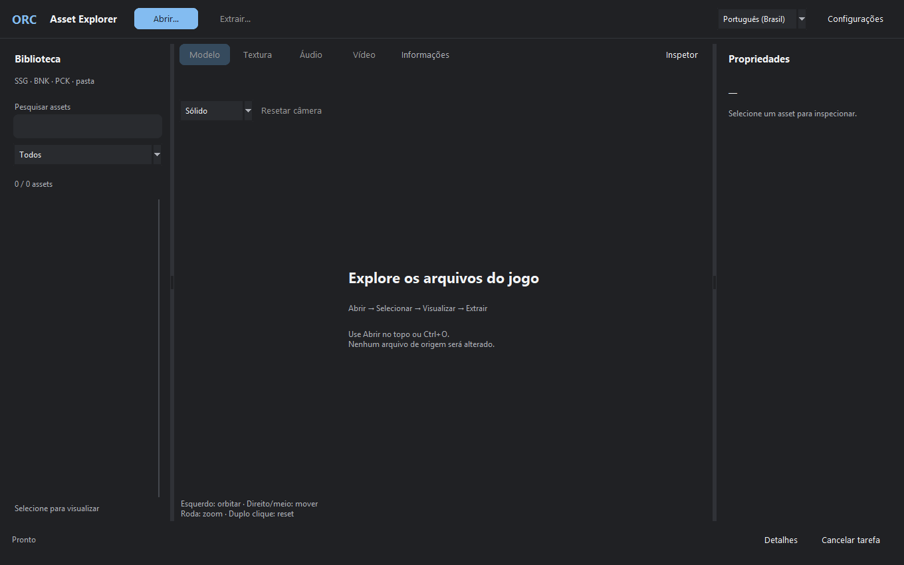
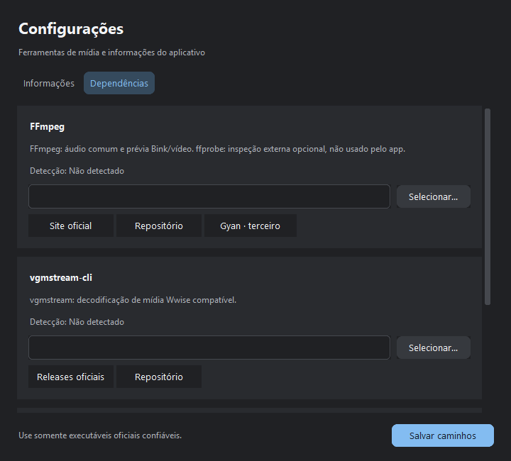

# ORC Asset Explorer — tutorial por função (PT-BR)

FullExport ainda não publicado; EXE canônico local e candidato possuem agora o mesmo SHA256 conferido independentemente. Evidências e lacunas: [cobertura](COVERAGE.pt-BR.md). Use apenas sua instalação, somente leitura.

## 1. Abrir arquivos e pastas
- **Abrir… → Abrir SSG / BNK / PCK**, ou **Ctrl+O**: escolha `.ssg`, backup `.bak`, `.bnk` ou `.pck`. Arquivos de mídia soltos (`.wem`, `.wav`, `.ogg`, `.mp3`, `.fsb`, `.bik`, `.bk2`, `.mp4`, `.avi`) também podem ser abertos pelo filtro **Todos**. O nome do comando principal ainda destaca os contêineres.
- **Abrir… → Abrir pasta**, ou **Ctrl+Shift+O**: escolhe uma pasta extraída; o app a percorre sem alterar seus arquivos.
- Aguarde **Abrindo / indexando**. A Biblioteca identifica a origem, contagem e itens. Em SSG com FM6S compatível, seleciona a primeira malha e abre Modelo automaticamente.
- **Cancelar tarefa**, ou **Esc**, solicita interrupção segura. Aguarde o worker terminar. SSG tem limite de entrada de 1 GB e cache descompactado de 4 GB. PCK é indexado sem ler todo seu corpo e pode exceder 1 GB.

## 2. Biblioteca, seleção e filtros
- **Pesquisar assets** (foco por **Ctrl+F**) filtra nomes. O seletor **Todos / Modelos / Texturas / Áudio / Vídeo / Outros** e extensões restringe a categoria. Os nomes exibidos são basenames; Propriedades mostra o caminho interno.
- Clique um item para prévia. **Ctrl+clique** e **Shift+clique** selecionam múltiplos para extração. A prévia corresponde ao primeiro selecionado, não a todas as seleções.
- Rodapé da Biblioteca: **Selecionado: nome** quando há seleção; **Selecione para visualizar** quando não há. Alterar filtro limpa a seleção e a prévia anterior. Busca sem resultado exibe **Nenhum resultado.**, limpa imagem/malha/propriedades e desabilita exports/reprodução irrelevantes. Limpar a busca retorna a lista; selecione novamente.
- Abas **Modelo / Textura / Áudio / Vídeo / Informações** trocam contexto; categorias ausentes ficam desabilitadas. **Inspetor** oculta/reabre Propriedades. Arraste divisórias para ajustar largura. O mínimo de cliente 1024×680 mantém status, **Detalhes** e **Cancelar tarefa** acessíveis.

## 3. Modelos, câmera, materiais e rig manual
1. Selecione `.edgemodel` FM6S, versões 17/18 suportadas. **Texturizado** é escolhido quando o DDS difuso é resolvido; caso contrário, **Sólido**.
2. Seletor **Wireframe / Sólido / Texturizado** altera a apresentação. Botão esquerdo arrastado orbita; direito ou meio arrastado move (pan); roda muda zoom; duplo clique ou **Resetar câmera** restaura a vista.
3. Em **Propriedades → Modelos → Avançado: materiais / rig**:
   - **Referências de material** abre Informações com materiais, referências e avisos. Volte em Modelo.
   - **Helpers shadow** mostra geometria auxiliar identificada por nome; oculta por padrão. Ciano diagnóstico não é shader original.
   - **Carregar esqueleto…** recebe skeleton Edge, não HKX; **Overlay esqueleto** liga/desliga a sobreposição.
   - **Aplicar imagem guardada** atribui a imagem manual anterior a todos os materiais, sem reconstruir associação original.
4. **Limitação importante:** esqueleto escolhido manualmente é apenas overlay das transformações armazenadas. Um rig genérico pode ter linhas/helper/root fora do personagem e não estar associado à malha. Não se afirma bind pose anatômico validado, rig nativo correto, skinning, animação ou equivalência ao render do jogo; FBX opcional sem vínculo é separado.
5. IM6S é metadado de instância, não geometria; a prévia explica isso. Versões/strides não suportados recebem erro explícito. GPU OpenGL de hardware é obrigatória, sem fallback CPU; detalhes identificam o renderer real.

## 4. Texturas e imagem manual
- Aba **Textura** ou categoria **Texturas**: selecione DDS completo, PNG, JPG/JPEG, BMP ou TGA. Roda faz zoom, arrastar move. **Ajustar** restaura enquadramento; **Pixels 1:1** faz correspondência de pixels.
- **Exportar PNG…** abre Salvar e cria um PNG RGBA sem sobrescrever destino existente.
- **Avançado: textura manual → Usar imagem no modelo** guarda uma cópia da imagem; depois selecione modelo e **Aplicar imagem guardada**. Isso substitui todos os materiais e pode dar resultado escuro/incorreto; não é resolução automática.
- DDS de 4 bytes recebe **“Esta referência DDS de 4 bytes não contém pixels. Abra a textura DDS completa correspondente.”** em Informações, com hex; não vaza objeto PIL/BytesIO/endereço. A referência continua disponível para extração bruta.

## 5. Áudio e bancos
1. Abra BNK/PCK e selecione mídia interna `.wem` em **Áudio**. A prévia é metadados/hex; não usa parser SSG nem toca áudio automaticamente. A amostra real `6970.wem` foi validada no EXE.
2. **Reproduzir** decodifica para WAV PCM validado e solicita reprodução; **Parar** a interrompe. O QA confirma PCM não nulo, mas não mediu saída acústica/loopback.
3. **Exportar WAV…** abre Salvar; espere **WAV exportado: caminho** antes de abrir a saída. Não sobrescreve. Configure **vgmstream-cli** para Wwise ou FFmpeg para áudio comum; limite de áudio 256 MB.
4. **Abrir banco selecionado** abre banco físico em pasta; banco embutido deve ser extraído primeiro. Botão fica desabilitado para WEM, que não é banco.
5. BNK DIDX/DATA e PCK AKPK são índices de mídia. Eventos HIRC, prefetch e eventos do jogo não são reconstruídos; fragmento decodificável não prova som original completo.

## 6. Vídeo
- Abra mídia solta com **Todos** ou a pasta que a contém, selecione **Vídeo** e o item. Ajuste **Início (s)** (número).
- **Decodificar 10 segundos** gera quadros reais FFmpeg, até 10 s a 12 fps. A reprodução inicia após decodificar; **Reproduzir** reinicia a prévia; **Pausar** congela o quadro; **Exportar quadro PNG…** existe, mas a ação não foi verificada separadamente na cobertura frozen final; teste de PNG de textura não a comprova.
- Não há áudio sincronizado nem reprodução integral do filme. Configure FFmpeg em Dependências. Mensagens esperadas: início não numérico, decoder recusou arquivo, nenhum quadro decodificado.

## 7. Extração segura e cancelamento
1. **Extrair… → Extrair selecionados** copia a seleção; **Extrair todos** copia a origem inteira, inclusive itens ocultos pelo filtro.
2. Escolha pasta fora de origem/jogo/biblioteca protegida, de preferência nova e vazia. Subpastas são preservadas; duplicatas recebem `__duplicado_1`, etc.
3. Preflight recusa destinos existentes, paths inseguros, caracteres reservados e conflitos arquivo/diretório como `parent` versus `parent/child`, inclusive diferença de caixa no Windows, antes de escrever qualquer arquivo.
4. **Cancelar tarefa**, ou Esc, para em pontos seguros. Concluídos ficam; somente parcial criado pela operação é removido. Aguarde status final antes de fechar. QA do EXE cancelou escrita real de arquivo próprio de 2 GiB e verificou parcial removido + hash do concluído preservado.
5. Confira contagem e hashes quando a integridade importar. O QA selecionado/todos via diálogos nativos conferiu os 45 assets Ada e nomes duplicados; repetição no mesmo destino deu recusa e preservou hashes.

## 8. Informações, idioma e dependências
- **Informações → Texto / hex selecionado** mostra os primeiros bytes sem ler mídia grande inteira. **Detalhes** no rodapé expande status, GPU e origem.
- Topo **Português (Brasil) / English** traduz apresentação e persiste escolha, sem mudar nomes/dados dos assets.
- **Configurações → Informações → Limitações / ajuda** lista os limites. GPU não é uma dependência opcional dessa tela.
- **Configurações** usa navegação segmentada **Informações / Dependências**, sem o Notebook antigo. Informações traz limites e hardware real em cartões. O tamanho mínimo é 620×480; use a roda/rolagem para acessar conteúdo abaixo. **Salvar caminhos** permanece fora da área rolável.
- **Dependências** agrupa FFmpeg, vgmstream-cli e Blender opcional em cartões com função, **Detecção**, caminho editável e **Selecionar…**. Campos permitem navegação horizontal e cópia do caminho completo. **Detectado** significa arquivo encontrado: não comprova versão, autenticidade ou codec compatível. Use somente executáveis confiáveis.
- **Salvar caminhos** persiste os campos configurados e mostra **Caminhos salvos.** na própria janela. Caminho inexistente mostra erro local e não grava; falha de escrita também mostra erro sem anunciar sucesso. Cancelar o seletor preserva o campo anterior. Fechar/reabrir mantém os campos; reiniciar carrega os caminhos salvos.
- Links agrupados: FFmpeg **Site oficial / Repositório / Gyan · terceiro**; vgmstream **Releases oficiais / Repositório**. URLs originais preservadas; navegação final no browser não foi exercitada.

Settings: QA frozen 36/36 com abertura por evento Return CTk, seletor nativo/cancelamento de ambos os executáveis, páginas PT-BR/English, salvar/reiniciar, cópia/rolagem horizontal e rolagem compacta. Configurações originais restauradas byte a byte. Capturas são da janela Settings real; não houve HTML/mockup. DPI múltiplo e clique físico foreground não foram cobertos.

## 9. Erros e logs
- **Destino existente ou inseguro / já existente**: selecione nova pasta; nunca force sobrescrita. **Conflito arquivo/diretório**: nomes adversariais/incompatíveis na origem; corrija o conjunto externo, não o jogo.
- **Destino protegido**: não use origem/jogo/biblioteca. **GPU obrigatória**: driver e GPU de hardware; não há fallback CPU. **Prévia indisponível**: confira versão FM6S, integridade ou referência DDS. **Configure vgmstream / FFmpeg**: configure executável confiável.
- `explorer_errors.log` fica nos dados do app; cópia portable usa `ORC_Asset_Explorer_data` ao lado do EXE. Instalação reconhecida em `dist` pode usar a árvore de fonte irmã. Não envie logs sem revisar caminhos privados.

## 10. Extração da instalação e exportação Blender

### Extrair uma instalação completa
1. Use **Extrair… → Extrair jogo completo…**. Selecione a instalação, sempre somente leitura.
2. Escolha destino **novo ou vazio fora do jogo**. Não há sobrescrita; junctions/reparse points são rejeitados. Não use biblioteca existente como destino.
3. Escolha preservar loose relevantes. A lista explícita inclui DDS, MATB, EDGEMODEL, HKX, WEM/WAV/OGG/MP3/FSB, BIK/BK2 e PNG/TGA. SSG sempre entra no inventário. EXE, DLL, DRM, configurações e credenciais são excluídos.
4. BNK/PCK é opcional: copie os bancos ou extraia mídia dos layouts Wwise suportados, mantendo IDs/idiomas. Não reconstrói eventos HIRC ou trilha original completa.
5. Clique **Inventariar sem extrair**. O espaço usa tamanhos declarados de seções e reserva para cache; é estimativa, não garantia. Tamanhos desconhecidos ficam indicados. Ao mudar instalação/opções, refaça o inventário.
6. Clique **Iniciar extração em lote**. Streaming em blocos de 1 MiB, um arquivo SSG por vez. Limites mantidos: entrada SSG 1 GiB, cache descomprimido 4 GiB. Progresso informa arquivo e quantidade de seções; falhas/cancelamento nunca viram sucesso total.
7. **Cancelar tarefa** preserva concluídos e remove somente o parcial criado pela operação. Consulte `batch_report.json`: processados, falhas, unsupported, cancelados, não iniciados, tamanhos e SHA-256. Não há resume automático: use outro destino vazio.

### Exportar modelos
1. Abra SSG/pasta extraída e selecione modelo **FM6S 17/18** real; IM6S é metadado.
2. Use **Extrair… → Exportar modelos (Blender)…**, também no avançado recolhível de Modelos. Pode selecionar todos os FM6S da origem aberta.
3. Configure Blender oficial em **Configurações → Dependências** se necessário. A extração bruta não depende dele. Download oficial: https://www.blender.org/download/ ; código: https://github.com/blender/blender . Detecção de existência não valida autenticidade. Testado Blender 5.0.1.
4. Escolha FBX, blend e/ou GLB, destino novo/vazio e esqueleto opcional 20SE/ES02 ou SSG. Resolução automática procura mesmo nome na origem aberta e pasta `skel` irmã do SSG.
5. Use **Exportar e verificar no Blender**. Um processo background por modelo, script fixo confiável e lista de argumentos sem shell/Python interpolado. Cancelamento encerra só o processo da operação, nunca Blender do usuário. Bundles concluídos e relatórios de falha ficam preservados.
6. Mantenha a pasta inteira: `textures/*.png`, formatos escolhidos, `job.json`, `export_report.json`; agregado `model_export_report.json`. FBX/blend usam PNG externo relativo, nunca DDS empacotado; GLB embute PNG. Use **Abrir pasta de saída**.

### Limites comprovados
- Exporta posições, triângulos, UV, atribuições de material e diffuse resolvido. Não reproduz outros canais/shaders do jogo. Todos os LODs lidos ficam juntos; sem animação/separação automática. Remove somente polígonos com mesmos índices duplicados, avisando a contagem; não solda seams coincidentes. GLB pode dividir vértices.
- Esqueleto nativo real: hierarquia, nomes e matrizes locais/globais da rest pose, validados por limites/ciclos/finitude/escala unitária. Exportado **SEM VÍNCULO** quando encontrado. FBX/blend reimportados verificam hierarquia/rest pose. Skin GLB desativado; esqueleto pode virar nós, não armature deformável.
- **Paleta de ossos/associação skin nativa não comprovadas. Sem pesos, animação ou armature placeholder inventada.** Esqueleto encontrado não é rig deformável validado: `rig_validated: false`, zero pesos, aviso explícito.
- Validação reabre/reimporta os arquivos reais e compara triângulos/UV (tolerância 2e-4), texturas e hierarquia/matrizes de esqueleto sem vínculo (1e-3 quando aplicável). Contagens de vértices podem mudar em FBX/GLB. Não significa compatibilidade in-game ou writer nativo round-trip.
- Tweed instalado possui contagem inválida na tabela FM6S: extração bruta funciona, exportação de geometria rejeita honestamente. QA usa backup vanilla preservado e esqueleto real do jogo. Nenhum arquivo do jogo é reparado/alterado.
- Não redistribua assets do jogo. Blender/decoders são dependências externas com licenças próprias. Não inclua assets/binários de dependências em Git.

## Capturas e lacunas
Para editar posições nativas, siga [NativeBridge](../tools/native_bridge/README.pt-BR.md): extrair template, criar projeto CLI, ORC Complemento Blender, exportar novo arquivo e reler pasta aqui. Sem menu automático Explorer, aprovação no jogo ou substituição geral de modelos.
As quatro imagens públicas foram capturadas agora de uma cópia isolada da fonte real, sem assets e com campos de dependência vazios, sem salvar configuração original nem reescrever pixels. Não são capturas do EXE nem prova de todo QA. Câmera ortográfica; sem Shift-esquerdo especial. [Cobertura](COVERAGE.pt-BR.md) · [Addon separado](ADDON.pt-BR.md) · [Build](BUILD.pt-BR.md).
